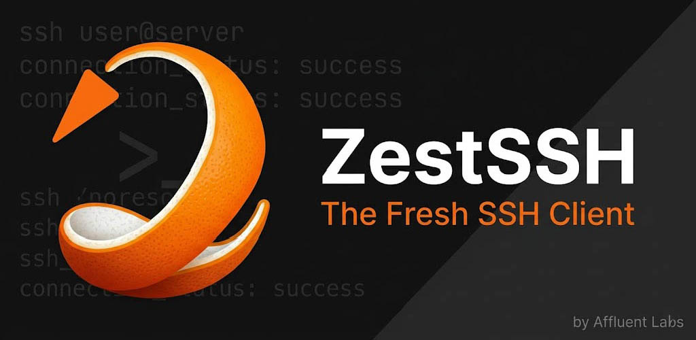
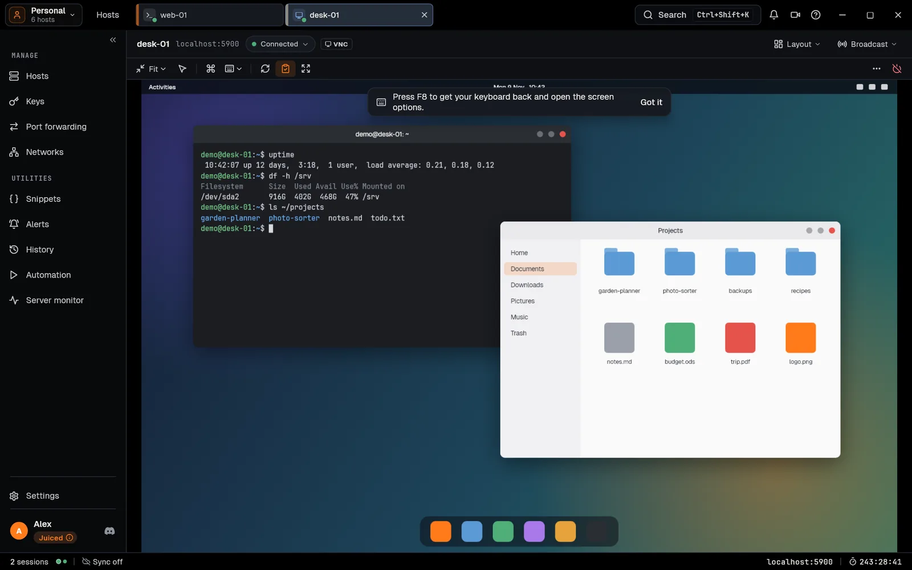
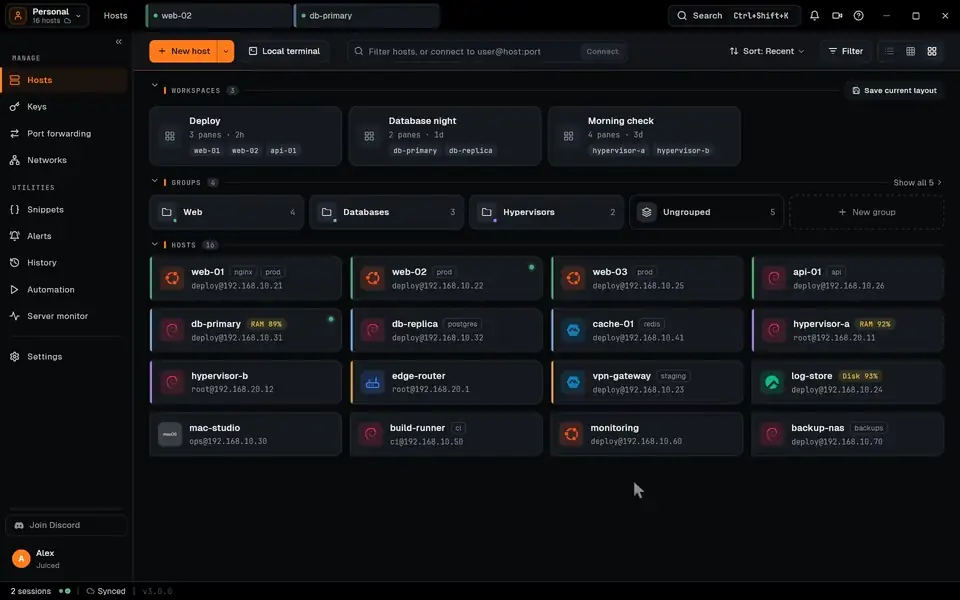
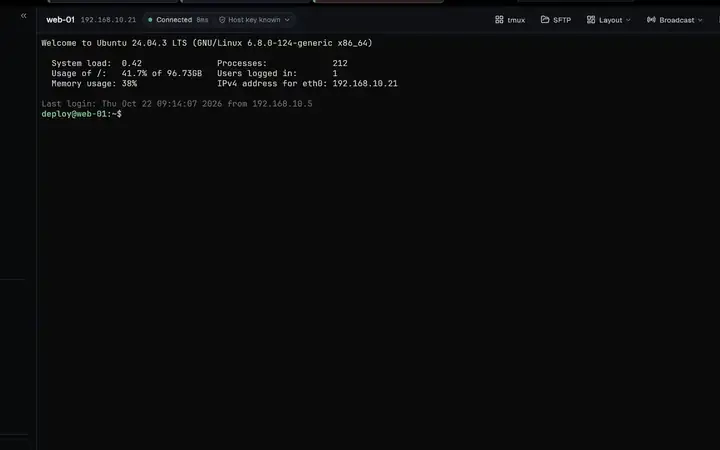
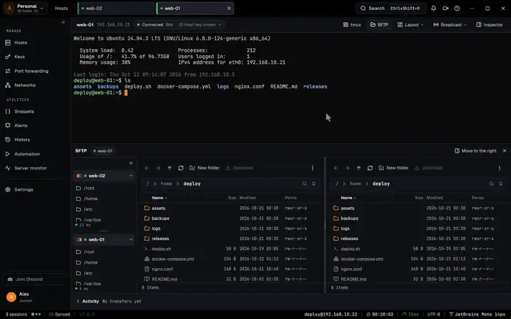
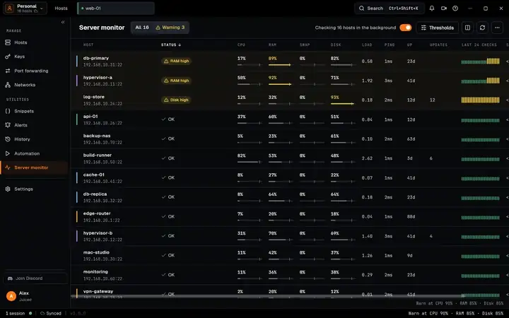
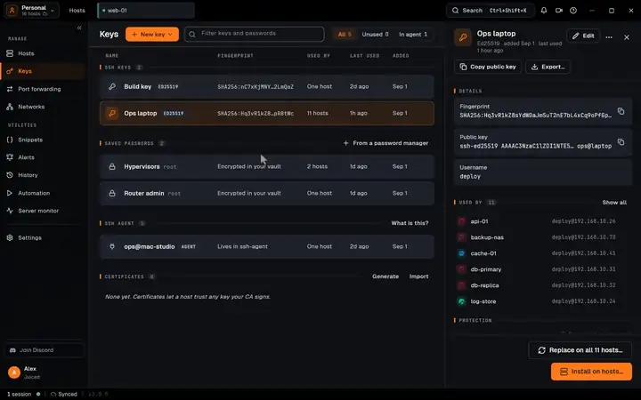
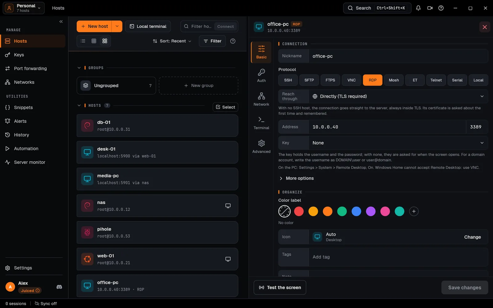
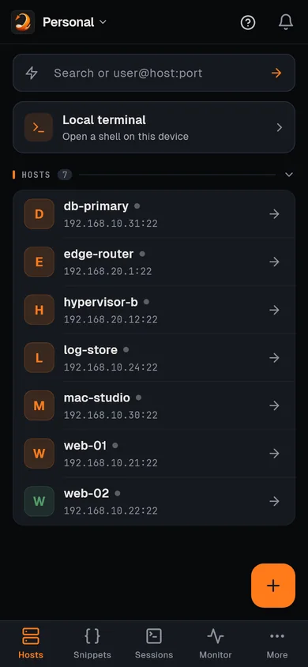

<p align="center">
  <a href="https://zestssh.com"></a>
</p>

<h1 align="center">ZestSSH</h1>

<p align="center"><b>SSH, files and remote desktops in one app</b>, on Windows, macOS, Linux, Android and iOS</p>

<p align="center">
  <a href="https://zestssh.com/download"></a>
  <a href="LICENSE"></a>
  
  <a href="https://docs.zestssh.com"></a>
  <a href="https://discord.gg/NnkUwxSdFX"></a>
</p>

<p align="center">
  <a href="https://zestssh.com/download"><b>Download</b></a> ·
  <a href="https://docs.zestssh.com"><b>Docs</b></a> ·
  <a href="https://zestssh.com/security"><b>Security whitepaper</b></a> ·
  <a href="BUILDING.md"><b>Build it yourself</b></a>
</p>

ZestSSH is an SSH client for every device you own: hosts, terminal, files, keys, tunnels and remote screens in one
app, with end-to-end encrypted sync. This is its full source, the same code the official builds are made from.

The reason it is public: an app that holds your keys and talks to your servers should be one you can read. How it
signs in, what it negotiates, where your data goes and what it never sends are all here, and the
[security whitepaper](https://zestssh.com/security) ties each claim it makes to the lines that do it.

It is built with Flutter, with its SSH engine in Dart ([`packages/zest_ssh_core`](packages/zest_ssh_core)) and its
native parts (FTPS, Mosh, the remote screen engine) in Rust ([`packages/zest_native`](packages/zest_native)).

## A look

The hosts, addresses and desktops in these pictures are made-up demo data.

<p align="center">
  
  <br><sub>New in 4.0: a computer's desktop over VNC or RDP, in a tab beside your terminals</sub>
</p>

<table>
  <tr>
    <td align="center" width="50%"><br><b>Hosts</b></td>
    <td align="center" width="50%"><br><b>Terminal</b></td>
  </tr>
  <tr>
    <td align="center"><br><b>Files</b></td>
    <td align="center"><br><b>Server monitor</b></td>
  </tr>
  <tr>
    <td align="center"><br><b>Keys</b></td>
    <td align="center"><br><b>An RDP host</b></td>
  </tr>
</table>

<p align="center">
  <br>
  <sub>And on phones and tablets.</sub>
</p>

## What it does

| | |
|---|---|
| **SSH and terminal** | Ed25519, Ed448, ECDSA and RSA keys, OpenSSH certificates, FIDO2 security keys, the system's agent, agent forwarding, jump hosts, port forwarding, Mosh (built in) and Eternal Terminal, tmux sessions, split panes. |
| **Files** | SFTP with two panes, FTPS, a text editor, folder sync. |
| **Remote screens** | VNC and RDP (through an SSH host, directly over TLS, or through an RD Gateway), X programs and the Proxmox console, in the app's own engine (a fork of vnc-rs, and IronRDP). RDP with up to four displays and sound; the clipboard both ways. |
| **Local data** | An SQLCipher database (Drift), its key in the system's keystore. |
| **Sync** | End-to-end encrypted (Argon2id and AES-256-GCM); free through your own storage (WebDAV, S3-compatible storage, Google Drive), or hosted by ZestSSH Cloud. |
| **Teams** | Shared vaults, roles, team certificates and session sharing, with a ZestSSH Cloud account. |
| **Accessibility** | Screen readers, the keyboard alone and larger text, in 12 languages. |

## Platforms

| Platform | Build host | Notes |
|---|---|---|
| Windows 10 and 11, x64 | Windows | Visual Studio C++ tools and OpenSSL 3 |
| Linux, x86_64 | Linux | GTK 3, libsecret, OpenSSL 3 |
| macOS 11 or later | macOS | Xcode, CocoaPods |
| Android 8.0 or later | any | Android SDK and NDK, JDK 17 |
| iOS 15 or later | macOS | Xcode, CocoaPods, an Apple developer team |

## Building

```
flutter pub get
flutter gen-l10n
flutter run
```

Flutter 3.50.0 (`.fvmrc`) and rustup are needed on every platform. [BUILDING.md](BUILDING.md) has the steps for
each platform, the build settings ([`.env.example`](.env.example)), the tests and the known gotchas.

Official release builds are compiled with `--obfuscate --split-debug-info`, and their debug symbols are kept off
this repository so that crash reports can be read back; a build of your own needs neither.

A build of your own is a community build: everything that runs on your device works, and what needs ZestSSH's
servers (signing in, ZestSSH Cloud, teams, purchases, the updater) is left out.

## Repository layout

```
lib/                  the app (Riverpod, GoRouter; screens in lib/ui and lib/features)
packages/
  zest_ssh_core/      the SSH library, a fork of dartssh2 (MIT)
  zest_native/        the Rust library: FTPS, the remote screen engine and Mosh
  xterm/              the terminal renderer, a fork of xterm.dart (MIT)
  desktop_multi_window/  detached windows, a fork (Apache-2.0)
  speech_to_text_windows/  speech to text on Windows, a fork (BSD-3-Clause)
  lucide_icons/       the Lucide icons for Flutter, a fork (ISC)
test/                 the tests (flutter test)
tool/                 developer tools: test servers, licence notices and checks
third_party/          the licences the app shows: its own, and those of its fonts and copied code
docs/                 design notes, the error codes and the self-hosted sync guide
```

[architecture.md](architecture.md) maps the code in more detail. The SSH library is also published on its own, with
its security posture spelled out, at [AffluentMods/zest_ssh_core](https://github.com/AffluentMods/zest_ssh_core).

## Contributing

Issues and pull requests are welcome. Contributions are accepted under the contributor licence agreement in
[CLA.md](CLA.md); [CONTRIBUTING.md](CONTRIBUTING.md) says how a change is made and reviewed. Questions and ideas are
also welcome on [Discord](https://discord.gg/NnkUwxSdFX).

## Security

Please do not report a security problem in a public issue. The disclosure policy and its contact are at
https://zestssh.com/security-disclosure, and in [SECURITY.md](SECURITY.md).

## Licence

ZestSSH is free software, licensed under the GNU General Public License version 3 only ([LICENSE](LICENSE)), with an
additional permission under its section 7 ([LICENSE-EXCEPTION.txt](LICENSE-EXCEPTION.txt)) that lets the app be
linked with the closed libraries its official builds use: on Android, Google Play services, ML Kit, Firebase, the
Google Play libraries and the Amazon Appstore SDK, and the others that file lists. SPDX: `GPL-3.0-only`, with that
permission. Versions released before 4.0 were not published under this licence.

© 2026 Affluent Labs LLC. All rights reserved.

The packages under `packages/` that carry a LICENSE file of their own keep it (zest_ssh_core and xterm are MIT), as
do the vendored code and crates in `packages/zest_native/rust` and the fonts and code in `third_party/`. The app
lists these licences under About, Open source licenses (native libraries on Windows and Linux). [NOTICE](NOTICE) sums it up.

"ZestSSH" and its logo are trademarks of Affluent Labs LLC and are not licensed under the GPL: see
[TRADEMARKS.md](TRADEMARKS.md).
